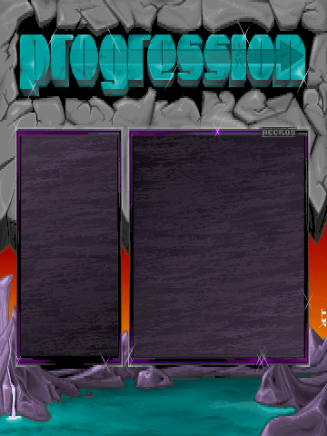
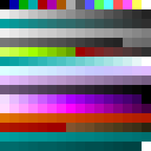
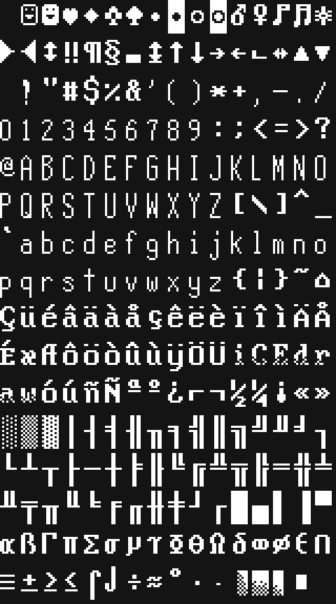
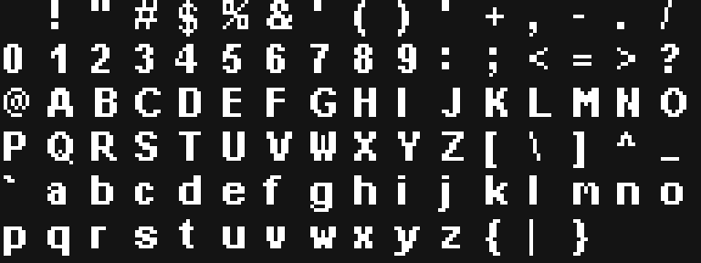
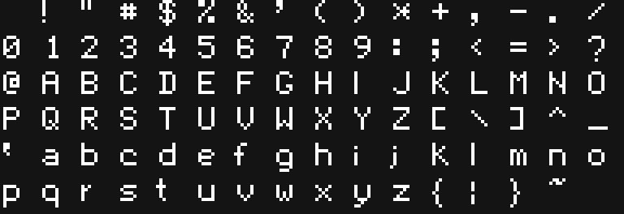

# Progression (Necros / FM, 1995) - what the "effects" are

*Progression* is a music disk, not a demo: `PROG.EXE` (114 KB, Watcom C 10.0 + PMODE/W 1.16 + DSIK 2.05 sound library) plays six ScreamTracker 3 modules
(`METROPLX`, `CROSSING`, `COLLAGE`, `POINT`, `ISOTOXIN`, `GREYNOTE`) behind one static picture. There is **no scene, no 3D, no per-frame animation**.
What the program draws is a menu, a text panel, a progress bar and a ticker. This write-up is therefore short: it describes exactly those, plus the screen mode
they live in. Nothing here is guessed; the addresses are those of the 32-bit code object (`0x10000...`, see `REVERSE.md`), the listings are from
`_re/obj1.asm` / `_re/obj2.bin` (the unpacked LE objects dumped by `tools/le.py`).

## 1. Display: 360x480, unchained, 4:3

The mode setter is a 0xA7-byte stub at `0x30000`. It does `int 10h` mode 13h and then reprograms the VGA registers by hand:

```
30000: mov ax,0x13 / int 0x10         ; start from mode 13h
3000a: mov ax,0x604 ; out 0x3c4,ax    ; sequencer reg 4 = 06 : chain-4 off, odd/even off ("unchained", mode X)
30010: mov ax,0xf02 ; out 0x3c4,ax    ; map mask = all four planes (clear VRAM)
30024: mov al,0xe7  ; out 0x3c2,al    ; misc output: 480-line timing (negative sync)
30031: mov dx,0x3d4 ... and al,0x7f   ; clear CRTC reg 0x11 bit 7 (unlock regs 0-7)
30040: out 0x3d4,ax  with ax = 6b00 5901 5a02 8e03 5e04 8a05 0d06 3e07 4009 ea10 ac11 df12 2d13 0014 e715 0616 e317
```

Decoding the CRTC values that matter (VGA CRTC register meanings are standard, not derived from this binary):

* reg 1 `0x59` = 89: 90 character clocks displayed, i.e. 90 x 4 planes = **360 pixels** per line.
* reg 0x12 `0xdf` plus the overflow bit in reg 7 (`0x3e`, bit 1) = 0x1df = 479: **480 lines**.
* reg 0x13 `0x2d` = 45 words: logical line pitch **90 bytes per plane**.
* reg 9 `0x40`: max scan line = 0 (no line doubling, unlike mode 13h).

So the screen is 360x480x256, a mode with 1:1 pixel data but 480-line timing on a 4:3 monitor, hence pixels about 1.78x wider than tall (the port, and
`REVERSE.md`, say this). **The port does not emulate any of the CRTC**; it knows the geometry only from these numbers: the canvas is 360x480 and the CSS box is
`aspect-ratio: 4 / 3` (`web/css/site.css`), which is the aspect-ratio requirement of the brief. Because the original draws a 240-line look into 480 lines, the
menu font is drawn with every row doubled (section 3).

Everything is drawn into a **shadow buffer** (360x480 bytes at `0x48b8c`) and copied to the four planes by `0x10028` (see the asm write-up). The port keeps only the
shadow buffer (`buf` in `web/js/screen.js`) and paints it with the palette; the plane copy is a no-op for it.

## 2. The back-drop and the palette

`GFX.DAT` is an `mhwanh` file: a 32-byte header (the width 0x0168 = 360 and height 0x01e0 = 480 are in it), a 768-byte RGB palette, then 360x480 = 172 800
raw palette indices (204 distinct values are used). The loader (`0x108d3`) puts the palette and the picture in memory; `0x10985` (screen draw) copies the whole
picture into the shadow buffer with one `memcpy` of 0x2a300 = 172 800 bytes. The port does the same:

```js
export function loadGfx(dat) {
  return { pal: dat.subarray(32, 32 + 768), bg: dat.subarray(32 + 768, 32 + 768 + W * H) };
}
draw() { this.buf.set(this.g.bg); /* then menu + info panel */ }
```

The palette upload is `0x1088c`: it sets the DAC write index with `out 0x3c8` then writes 768 bytes to `0x3c9`, each `v >> 2` (the VGA DAC is 6 bits). `app.js`
expands those 6-bit values back to 8 bits for the canvas. The picture's text colours are plain palette entries chosen by the program:

* menu entries: colour 9 (0x5757ff, blue) when idle, colour 15 (white) for the selected one;
* ticker: colour 11 (0x57ffff, cyan);
* info panel line `n` (13 lines): colour `0x80 + n`. The palette entries 0x80..0x8c in `GFX.DAT` form a smooth ramp from (231,187,255) down to (139,111,155), so the
  panel text gets a **vertical gradient with no per-pixel work**: it is the palette, not the code, that does it.

The fade routines (`0x10080`, `0x10124`) are in the binary but dead code (nothing calls them; `REVERSE.md`), so there is no fade in the port either.

### 2b. 2D art inventory (checked against the files)

| file | size | layout | decoded by |
|---|---|---|---|
| `GFX.DAT` | 173 600 B | 32-byte `mhwanh` header (width 360 and height 480 are stored big-endian at offsets 8 and 10; offset 12 holds 0x0100) at 0; **palette at offset 32, 768 B** (256 x RGB, 8 bit); **pixels at offset 800, 172 800 B** = 360x480 raw indices, row-major, no compression | `loadGfx` (`screen.js`); original loader `0x108d3` |
| `VGA.FNT` | 4096 B | 256 glyphs x 16 bytes, one byte per row, msb = leftmost pixel; 253 of the 256 glyphs are non-empty | `textVga`; original `0x1032e` |
| `FONT2.FNT` | 1060 B | 4-byte header (first char 0x20, height 10), then 96 records of 10 row bytes + 1 width byte (chars 0x20..0x7f); rows lsb-first | `loadFnt` + `textFnt`; original `0x101c5` / `0x104cb` |
| `FONT.FNT` | 964 B | same format, first char 0x20, height 9, 96 records; loaded by the EXE but never drawn | not used by the port |

Colours: the palette has 256 entries, of which 225 are distinct RGB values; the picture uses 204 distinct indices (maximum index 254). The shadow buffer stores
indices, never RGB; the canvas applies the palette at paint time. Previews, rendered for this write-up straight from the shipped files (`figures/`; the picture is at its native 360x480 pixels, not aspect corrected):











(`_re/gfx.png`, made earlier by the project, is another render of the GFX.DAT picture.)

## 3. The two fonts

Both text routines are plain bit-test loops writing one byte per set pixel into the shadow buffer; the port mirrors them function for function.

**VGA text, `0x1032e`** (info panel, ticker): glyphs from `VGA.FNT` (256 x 16 bytes, one byte per row, msb first), 8 wide, drawn on a **6-pixel pitch**. The shipped
`VGA.FNT` is a narrow 5-pixel face, so successive glyphs touch their neighbours' empty column instead of overlapping. Only set bits are written (transparent
background, so the picture shows through):

```js
export function textVga(buf, vga, s, x, y, col) {
  for (let i = 0; i < s.length; i++) {
    const ch = s.charCodeAt(i);
    for (let c = 0; c < 8; c++) for (let r = 0; r < 16; r++)
      if (vga[ch * 16 + r] & MASK[c]) buf[(y + r) * W + x + c + 6 * i] = col;
  }
}
```

**Menu font, `0x104cb`**: `FONT2.FNT` is a proportional bitmap font (4-byte header `[first char, ?, height, ?]`, then per glyph `height` rows and one width byte, **lsb
first**). The routine writes every pixel **twice, on rows `y+2r` and `y+2r+1`**, which is how a 10-row font fills the 480-line mode; a space advances 6 pixels, other
glyphs advance their own width byte. `FONT.FNT` is loaded by the original but never used.

```js
for (let r = 0; r < font.h; r++)
  for (let c = 0; c < w; c++)
    if (b & MASK_LSB[c & 7]) { buf[(y + 2*r)*W + x + ofs + c] = col; buf[(y + 2*r)*W + W + x + ofs + c] = col; }
```

## 4. Menu and panel

`0x10985` draws the six titles at x = 25, y = 160 + 40 i (the listing shows `y = i*5*8 + 0xa0`), colour 9, then redraws entry 0 in colour 15 and the 13 info lines
of song 0 at x = 148, y = 154 + 16 n. Selecting another song (`0x10a66`) redraws the old entry in 9, the new one in 15, restores the panel rectangle
(x 148..340, y 154..380) from the back-drop copy and writes the new text. The texts (menu, 6 x 13 info lines, 30 ticker lines) live in the data object;
`tools/extract_strings.py` dumps them to `web/assets/strings.json`.

## 5. Timing: a 70 Hz tick, a progress bar and a ticker

The program reprograms the PIT with divisor `0x4295` (about 70 Hz) and installs the callback `0x105fe`. After calling the DSIK library (`call 0x12174`) it
increments a sub-counter and, past 70, bumps a "seconds" counter:

```
1060f: mov edx,[0xa44f4] / inc edx / mov [0xa44f4],edx
1061c: cmp edx,0x46 / jng skip        ; 0..70 : 71 ticks per "second"
10621: mov [0xa44f4],0 / inc [0xa44f0] ; seconds++
```

The drawing happens in the idle loop (`0x10d3b`...), not in the interrupt, keyed on that counter:

* **counter % 6 == 0**: redraw the progress bar. It clears 202 x 8 pixels at x 79.., y 419..426, then fills 6 rows (y 420..425) of colour 9 from x = 80, of width
  `200 * order / numOrders`. The two player fields read are the current order (`[player+0x60a]`) and the song length in orders (`[player+0x60b]`).
  **The bar is order-granular**, not sample-accurate: it moves in steps of 200/numOrders pixels.
* **counter % 25 == 0**: the ticker. The 16-row band y 450..465 is restored from the back-drop, the next of the 30 messages is drawn with `textVga`
  centred on x = 180 (the port: `180 - 3 * s.length`, 6 px per char), colour 11, and the message index wraps at 30.
* each of the two draws also executes `counter++` (`0x10e0a`...), so the same counter value is not tested twice and the redraws drift apart from the pure
  "every 6th / 25th second" schedule. The port keeps this quirk (`timer70()` in `screen.js`).

The seconds counter is a UI counter only: it is not the music clock. DSIK plays on its own interrupt.

## 6. What is exact and what is not

* **Exact**: the whole 360x480 screen. `tools/verify_screen.py` runs the EXE's own `0x10985` (screen draw) and `0x1032e` (VGA text) under Unicorn on the loaded
  objects; `tools/verify_screen.mjs` compares `web/js/screen.js` to the dump: 0 differing pixels for the initial screen and for a ticker line (per `REVERSE.md`;
  re-run both to confirm). The menu font routine `0x104cb`, the progress bar and the redraw schedule are ported from the same disassembly but are not part of
  that automated comparison.
* **Not the original**: the sound. The port plays the S3M files with libopenmpt (cubic-spline interpolation) instead of DSIK 2.05, so the mixing, interpolation
  and any DSIK quirks differ. Song position and seeking are libopenmpt's (the original has Left/Right = previous/next order; the port adds a slider and
  click-to-select on the menu).
* **Not emulated**: VGA planes, CRTC and DAC. They are replaced by a canvas with a 4:3 box and an optional CSS scanline overlay (display only).
* The port runs the UI at 70 ticks/s from `requestAnimationFrame` with an accumulator, not from a PIT interrupt.
